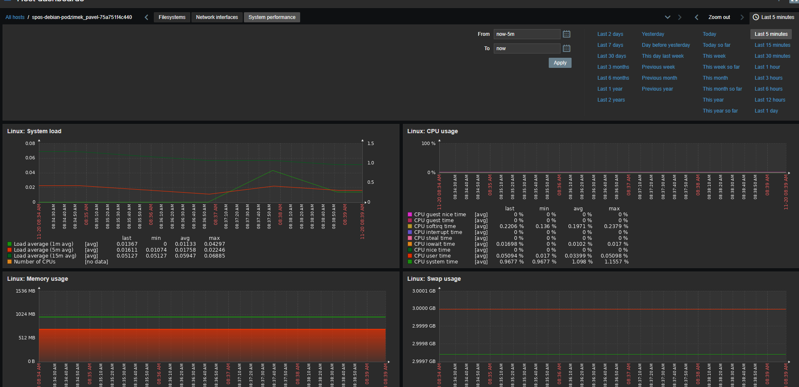
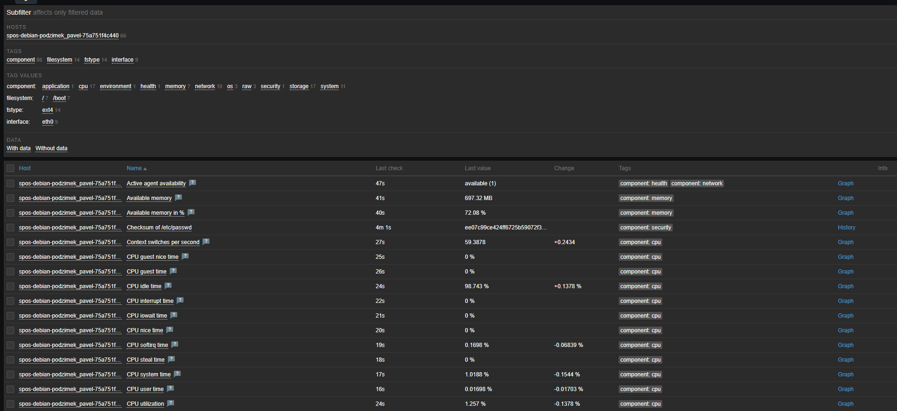

# Debian 13 + Zabbix Agent 2 (8.0 LTS) – auto-registrace


**Autor:** Pavel Podzimek (Paulie795), OSY 2026

## O co jde

Celý server se postaví jedním příkazem. Vagrant vytvoří VM s Debianem 13, nainstaluje do ní Zabbix Agent 2 ve verzi 8.0 LTS a nastaví ho tak, aby se sám přihlásil na školní Zabbix server `enceladus.pfsense.cz`. Nic se nedělá ručně uvnitř VM, všechno řeší skripty při provisioningu.

## Jak to spustit

```sh
vagrant up
```

Když upravím skripty, stačí `vagrant provision`. Pro úplně čistý start `vagrant destroy -f` a znovu `vagrant up`.

## Co dělají jednotlivé skripty

**`install-tools.sh`** – doinstaluje nástroje, které se hodí při ladění (`htop`, `btop`, `mc`, `nmap`, `netcat`, `git`, `vim`…).

**`install-zabbix8-agent2.sh`** – přidá repozitář přímo od Zabbixu (ne ten z Debianu, tam je starší verze) a nainstaluje `zabbix-agent2`. Na konci si zkontroluje, že je opravdu verze 8, jinak skončí chybou. Když už agent 8 nainstalovaný je, instalaci přeskočí, takže opakovaný provisioning nic nerozbije.

**`configure-zabbix8-agent2.sh`** – nastaví agenta:

| Parametr | Hodnota | Proč |
|---|---|---|
| `Server` | `enceladus.pfsense.cz` | odkud se smí ptát server |
| `ServerActive` | `enceladus.pfsense.cz` | kam agent sám posílá data |
| `HostMetadata` | `SPOS` | podle toho server pozná, jaké pravidlo auto-registrace použít |
| `Hostname` | `spos-debian-podzimek_pavel-<12 znaků>` | moje jedinečné jméno v Zabbixu |

Jméno se vygeneruje z náhodného UUID jen jednou a uloží se do `/var/lib/zabbix/spos-hostname`. Při restartu nebo dalším provisioningu se použije to uložené, takže se v Zabbixu nevytvoří duplicitní host. Před zápisem do konfigurace skript smaže staré řádky se stejnými parametry, aby tam nebyly dvakrát.

## Port

Ve `Vagrantfile` je přesměrovaný port 80 z VM na `localhost:8080`.

## Kontrola, že to běží

```sh
vagrant ssh
cat /var/lib/zabbix/spos-hostname
zabbix_agent2 -V
systemctl status zabbix-agent2
grep -E '^(Hostname|Server|ServerActive|HostMetadata)=' /etc/zabbix/zabbix_agent2.conf
sudo tail -n 5 /var/log/zabbix/zabbix_agent2.log
```

V logu je při prvním spuštění vidět `host [...] not found` a hned potom `active checks on server are active again`. To znamená, že server agenta nejdřív neznal, auto-registrace ho založila a od té chvíle přijímá data.

## Výsledek

Host `spos-debian-podzimek_pavel-75a751f4c440` se zaregistroval, má štítky `OS: Linux`, `class: os`, `target: linux` a je ve stavu Enabled:



Z hosta chodí data (dostupnost agenta, paměť, CPU…):



## Problémy, na které jsem narazil

- `zabbix_agent2 -V | head -1` shodil skript kvůli `set -o pipefail` (agent dostal SIGPIPE, když `head` zavřel rouru). Opraveno na `sed -n 1p`.
- Šedá ikona ZBX u hosta není chyba. Agent pracuje v aktivním režimu, takže pasivní kontrola zvenku na port 10050 neprojde, ale data se přesto posílají.

## Odkazy

- [Instalace Zabbixu z balíčků (8.0)](https://www.zabbix.com/documentation/8.0/en/manual/installation/install/packages)
- [Parametry Zabbix Agent 2](https://www.zabbix.com/documentation/8.0/en/manual/concepts/agent2/agent2_params)
- [Auto-registrace aktivních agentů](https://www.zabbix.com/documentation/8.0/en/manual/discovery/auto_registration)
